# Double-layer Optimization Configuration of Multi-Microgrid System Based on Energy Storage Power Station Services (Matlab Code Implementation)

1. Editing
Based on the above research status, the current research on shared energy storage is still in its initial stage. The existing foundation focuses on the operational decision-making and business models of shared energy storage service operators, with a single type of user load. There is less analysis on users' charging and discharging behaviors when using shared energy storage and the cost settlement between users and shared energy storage. Additionally, there is limited research on applying shared energy storage to the optimization configuration of multi-microgrid systems that combine heating, cooling, and power generation. Addressing these issues, this paper proposes a dual-level optimization configuration for the multi-microgrid system that integrates heating, cooling, and power generation based on energy storage station services, establishing a bi-level programming model (BLP) that considers both the capacity allocation of energy storage stations and the optimization operation of the multi-microgrid system.
Firstly, the service model for energy storage stations is proposed; then, a dual-level optimization configuration model is established considering planning and operation, which uses the KKT conditions and Big-M method to convert the dual-level model into a single-level linear model for solution. Finally, simulation examples are analyzed to verify the economic and effectiveness of the proposed model. The innovations of this paper are summarized as follows:
1)Propose the service model for energy storage stations, analyzing their operational methods and profit mechanisms;
2)Apply this model to the multi-microgrid system that integrates heating, cooling, and power generation, achieving mutual complementarity among various types of internal energy within users;
3)Use a dual-level model to establish energy storage decisions that take into account the interests of both energy storage station operators and the multi-microgrid system.
The Energy Storage Station Control Center implements the power plan for charging and discharging energy storage for each user at different times according to the service agreement. It transfers the surplus electrical energy needed for energy storage charging services to users who need energy storage discharge services through the shared energy storage station. During the same time period, all users connected to the same shared energy storage station have a total demand for charging or discharging, and the Control Center uses energy storage devices to charge or discharge the surplus electrical energy of the user group. Based on the power requirements of all users in each period, the Control Center allocates corresponding capacities and maximum charging/discharging powers.
2. Running Results Editing
Editing
Editing
Editing
Editing
Editing
Editing
Editing
Editing
Editing
Part of the code:  
%Big-M method for handling shear plane constraints  
for i = 1:3  
    for t = 1:24  
        Con = [Con,  
            0 <= u1itmin(i,t) <= M*v15(i,t),  
            0 <= PGTwi(i,t) - 5 <= M*(1-v15(i,t)),  
            0 <= u1itmax(i,t) <= M*v16(i,t),  
            0 <= 3000 - PGTwi(i,t) <= M*(1-v16(i,t)),  
            0 <= u2itmin(i,t) <= M*v17(i,t),  
            0 <= QACwi(i,t) - 5 <= M*(1-v17(i,t)),  
            0 <= u2itmax(i,t) <= M*v18(i,t),  
            0 <= 4000 - QACwi(i,t) <= M*(1-v18(i,t)),  
            0 <= u3itmin(i,t) <= M*v19(i,t),  
            0 <= PECwi(i,t) - 5 <= M*(1-v19(i,t)),  
            0 <= u3itmax(i,t) <= M*v20(i,t),  
            0 <= 4000 - PECwi(i,t) <= M*(1-v20(i,t)),  
            0 <= u4itmin(i,t) <= M*v21(i,t),  
            0 <= QGBwi(i,t) - 5 <= M*(1-v21(i,t)),  
            0 <= u4itmax(i,t) <= M*v22(i,t),  
            0 <= 4000 - QGBwi(i,t) <= M*(1-v22(i,t)),  
            0 <= u5itmin(i,t) <= M*v23(i,t),  
           ]
0<=PHXwi(i,t)-5<=M*(1-v23(i,t)),  
0<=u5itmax(i,t)<=M*v24(i,t),  
0<=4000-PHXwi(i,t)<=M*(1-v24(i,t)),  
0<=u6itmin(i,t)<=M*v25(i,t),  
0<=Pgridwi(i,t)<=M*(1-v25(i,t)),  
0<=u6itmax(i,t)<=M*v26(i,t),  
0<=4000-Pgridwi(i,t)<=M*(1-v26(i,t)),  
0<=u7itmin(i,t)<=M*v27(i,t),  
0<=Pessswi(i,t)<=M*(1-v27(i,t)),  
0<=u7itmin(i,t)<=M*v28(i,t),  
0<=(4000*Usalewi(i,t)-Pessswi(i,t))<=M*(1-v28(i,t)),  
0<=u8itmin(i,t)<=M*v29(i,t),  
0<=Pessbwi(i,t)<=M*(1-v29(i,t)),  
0<=u8itmin(i,t)<=M*v30(i,t),  
0<=(4000*Ubuywi(i,t)-Pessbwi(i,t))<=M*(1-v30(i,t)),  
0<=u9itmax(i,t)<=M*v31(i,t),  
0<=(1-Ubuywi(i,t)-Usalewi(i,t))<=M*v31(i,t),  
];  
end  
end  
🎉3 References
🌈4 Matlab code + data

## Images

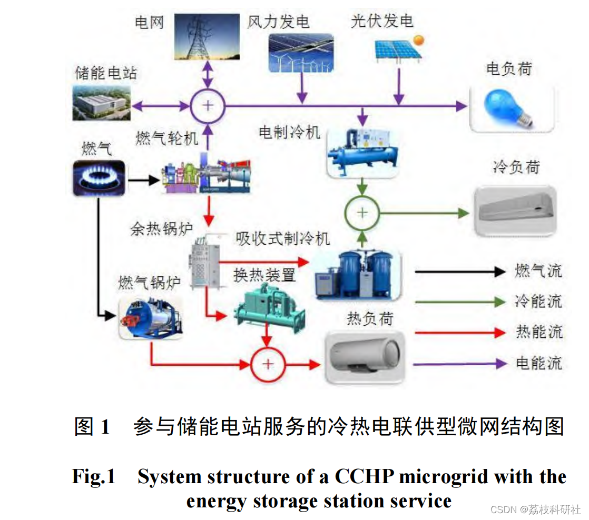
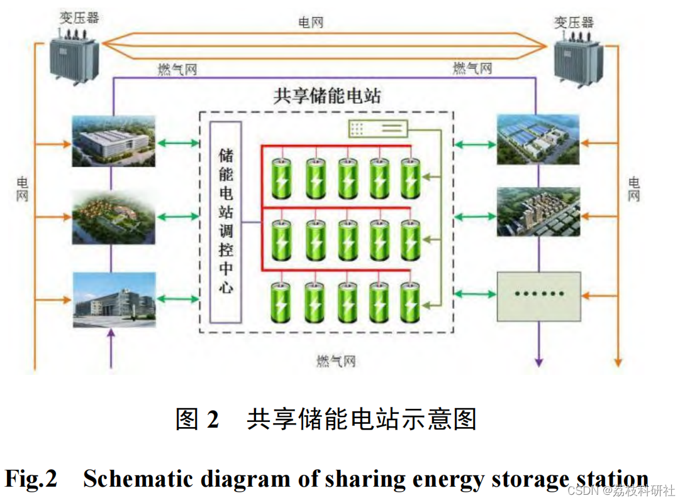
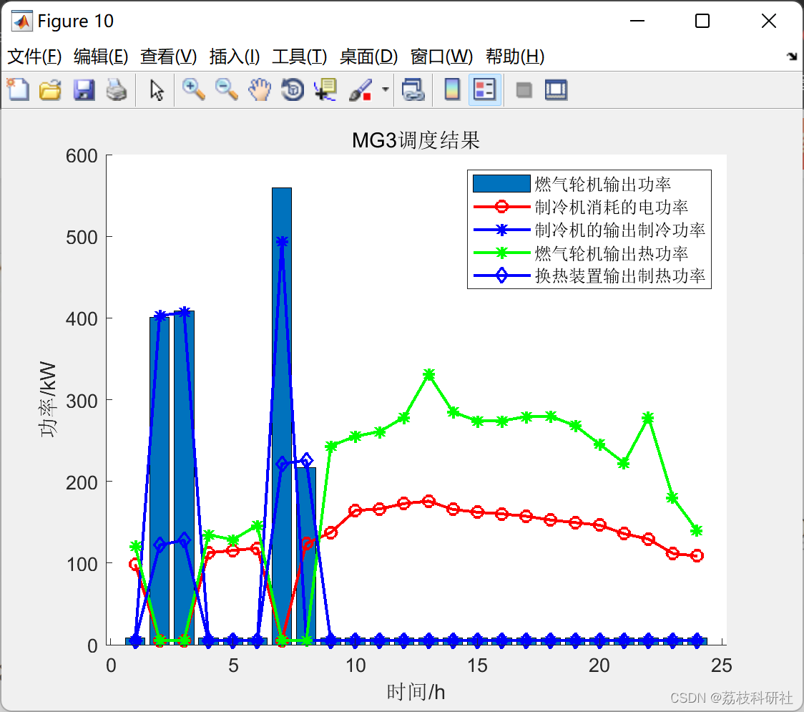
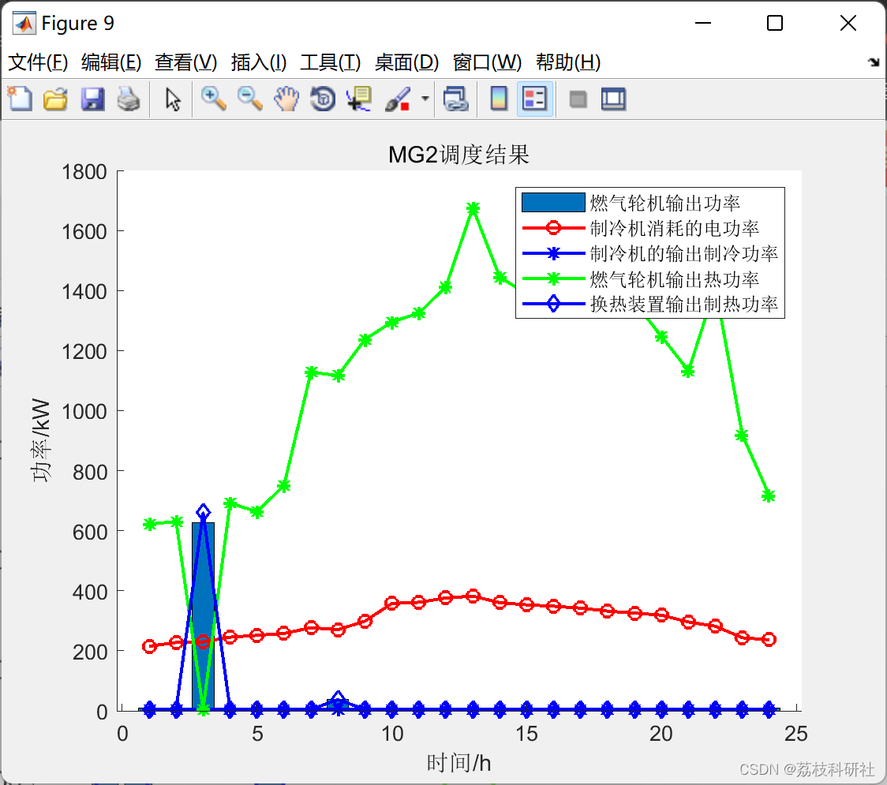
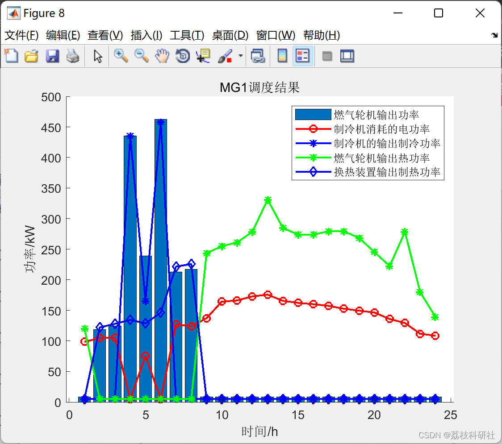
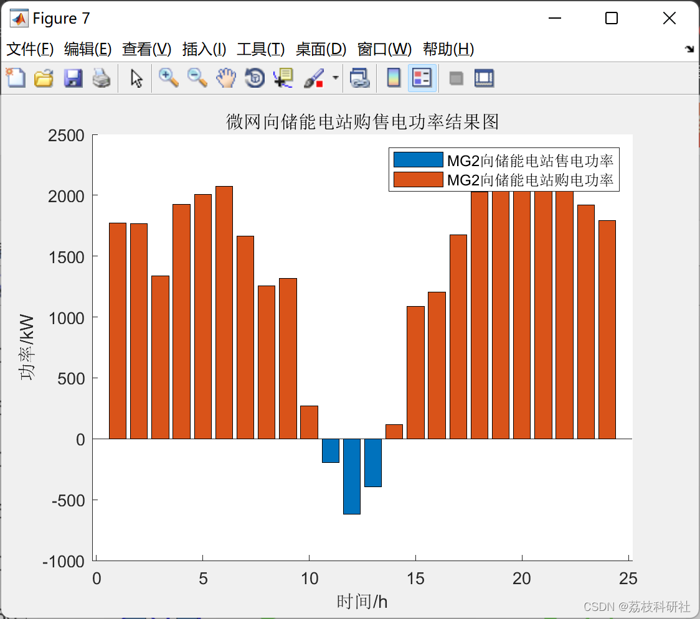
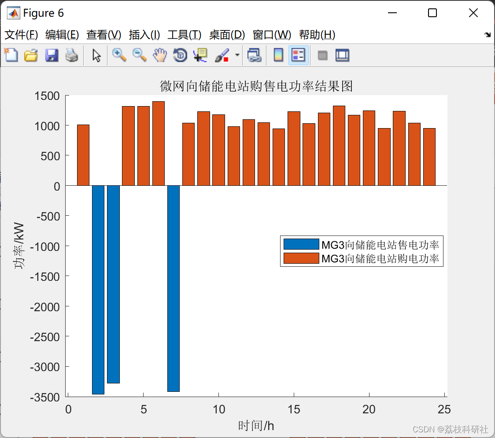
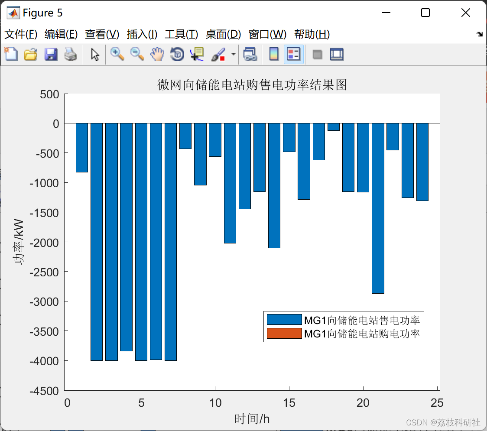
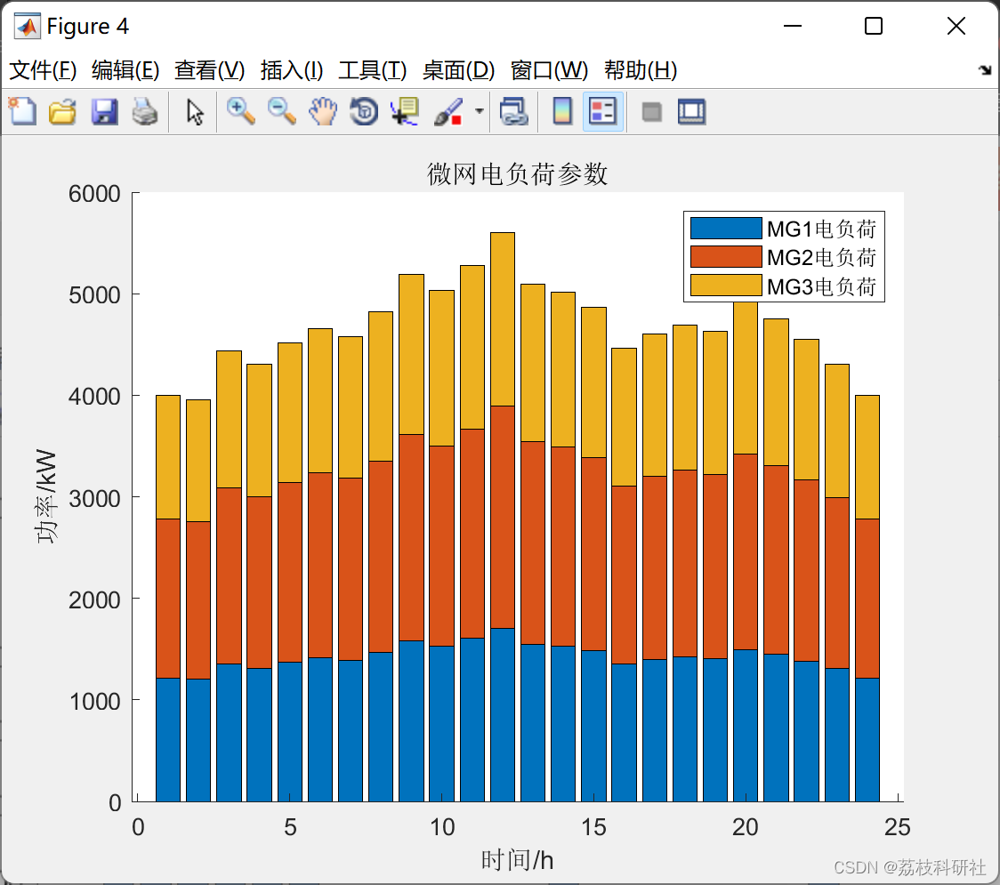
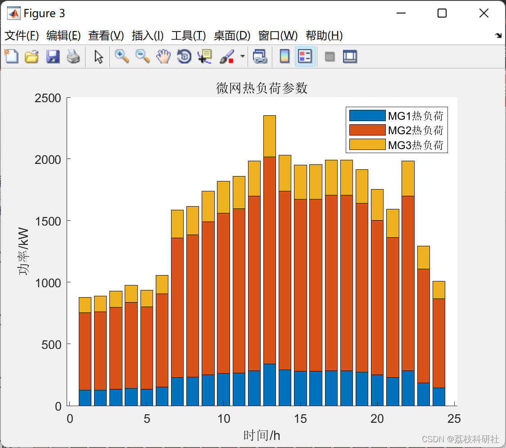
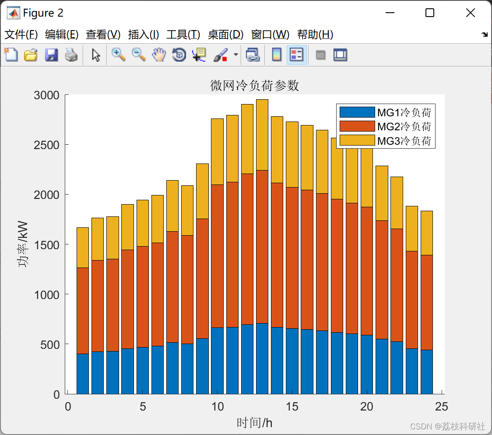
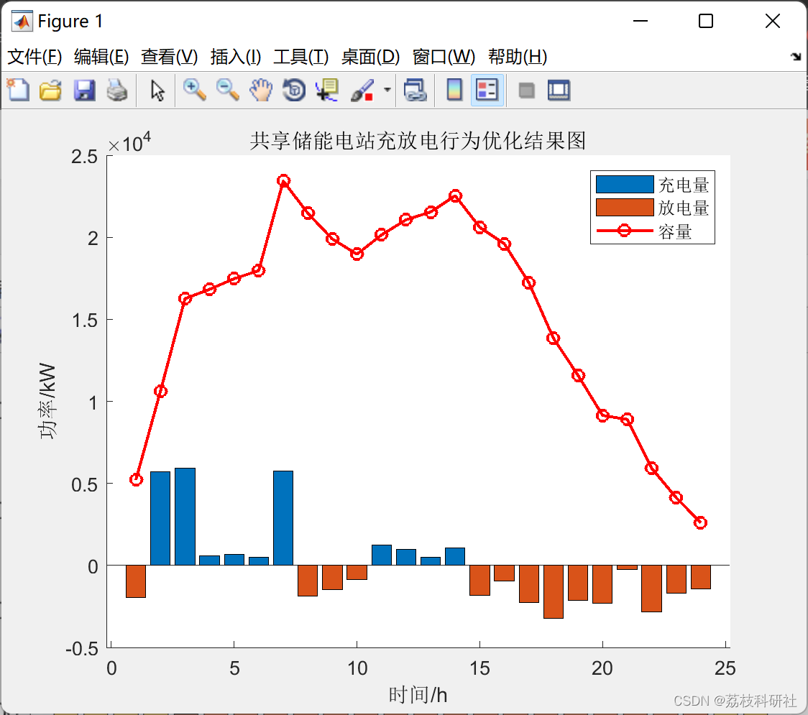

<!-- PAYMENT_BLOCK -->

## Get this dataset

- Payment link (Stripe): [Buy now](https://buy.stripe.com/3cs8yP7sY87d0vu9AB)
- Payment QR code: 

<!-- /PAYMENT_BLOCK -->
